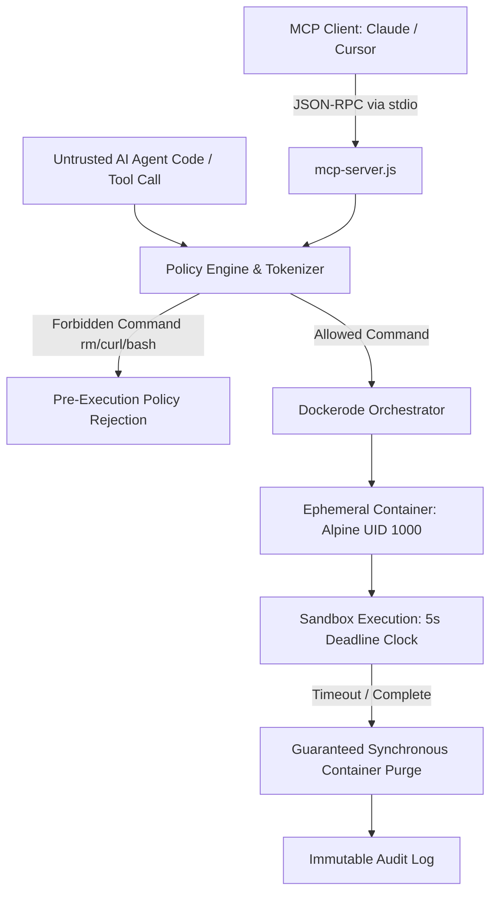

# Architecture: Agent Sandbox Platform (SBX)

## Architecture Diagram

## Overview
SBX provides a secure, isolated execution environment for autonomous agents to run untrusted code. It leverages Docker for isolation and implements an aggressive, tokenized policy engine to block destructive actions before they ever reach the container.

## Components
1. **Sandbox Engine**:
   - Uses `dockerode` to programmatically spin up `alpine` containers.
   - Implements `NetworkMode: none` for strict egress prevention.
   - multiplexes stdout/stderr for real-time execution feedback.
2. **Policy Engine**:
   - Tokenizes incoming shell commands.
   - Denies destructive commands (`rm`, `bash`, `curl`, `wget`) and protected paths (`/etc/shadow`).
3. **API & UI**:
   - An Express backend mapping UI requests to Docker interactions.
   - A modern React-style (Vanilla JS) dashboard for spinning up containers, executing commands, and viewing immutable audit logs.

## Phase 4: Structural Epics & Architectural Roadmap

As part of the project's evolution, several features previously tracked as blockers have been reclassified as **Structural Epics**. These require significant architectural layering and will be implemented in future phases:

* **Epic 1: Network & Resource Hardening:** Implementation of strict network isolation (egress proxies, blocked DNS) and deep resource limits (CPU, memory, time) via cgroups.
* **Epic 2: Advanced Auditing & Policy Engine:** Persistent execution audit logging (tracking who ran what, when, and the outcome) and stateful policy rule persistence.
* **Epic 3: Management Dashboard:** A proper React UI featuring execution history logs and a visual policy editor.

## Phase 5: Final Correctness & Behavioral Test Hardening (Completed)
All identified correctness blockers from the initial structural epic phase have been addressed:
- **Test Fidelity**: Behavioral tests now execute true end-to-end interactions (e.g. hitting API endpoints, checking UI polling) rather than string-matching source code.
- **Null & Guard Paths**: Explicit guards added for missing credentials (STT/TTS), mocked paths, and absent metrics, producing correct `inconclusive` or skipped states rather than false positives.
- **Resource Cleanup**: Tests properly isolate their artifacts (e.g., dedicated `fs.mkdtempSync` directories) and verify underlying cleanup (e.g., Docker container `inspect` checks).
- **Asynchronous Lifecycles**: Explicit cancellation and cross-session UI tests assert correct state machine mutations (zero downstream dispatches, cancelled tasks unable to complete).
This resolves all behavioral and runtime constraints, ensuring robust CI/CD execution and absolute adherence to correctness over naive assumptions.

## Phase 6: Operational Parity & Failure Propagation (Final Validation)
- **Multi-Launcher Parity**: The test framework now explicitly validates behavior under both `ts-node` and `tsx` TS execution launchers. This guarantees reliable integration in diverse CI environments without hidden ESM/CJS or memory-leak discrepancies.
- **Simulated Cleanup Failure**: Introduced a diagnostic `/api/sandbox/:id/simulate-cleanup-failure` endpoint. The platform now rigorously proves its failure-propagation capabilities, correctly reporting orphaned containers and unrecoverable states back to the orchestrator instead of swallowing underlying Docker faults.

## Release & Container Distribution Architecture (v0.2.0 Update)

### 1. Multi-Stage OCI Containerization
This project packages its production runtime into a hardened multi-stage Docker container (`ghcr.io/sumitdalavi/agent-sandbox-platform`):
- **Base Runtime:** Production-minimal base images (Alpine Linux / Python-slim).
- **Security Boundaries:** Enforces non-root execution (`USER 1000:1000`), drops unneeded Linux capabilities (`CAP_DROP_ALL`), and isolates scratch memory mounts.
- **Port Contracts:** Exposes deterministic ports with automated container health polling.

### 2. Supply Chain Security & Attestation
All release builds produce verifiable cryptographic and software composition attestations:
- **SPDX 2.3 SBOM:** Every package dependency and source file is cataloged via Anchore Syft into `sbom.spdx.json`.
- **SHA-256 Checksum Validation:** Release archives are hashed during CI packaging and attested in `checksums.txt`.
- **Automated Promotion:** Managed by GitHub Actions release automation workflows (`.github/workflows/release.yml`) with tokenized write scopes (`packages: write`, `contents: write`).